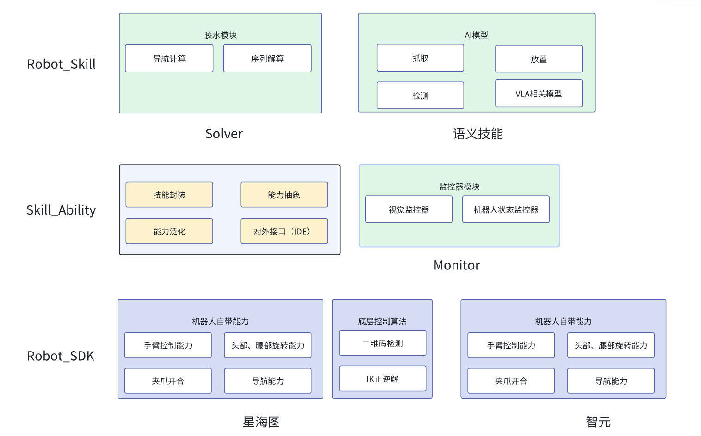
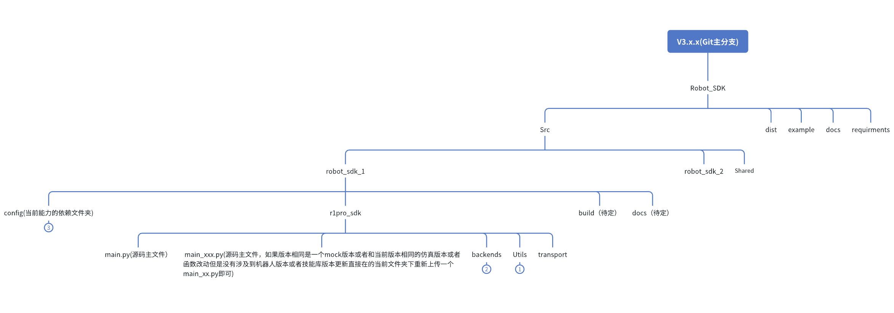

# R1 Pro Robot SDK
# 提交规范

```markdown
- 分支建立规范：
V3.x.x - 主分支
develop-name  - 开发分支  --示例 develop-刘鑫（开发结束后都需要合到主分支）
feature/功能名 - 功能开发分支 --示例 feature-刘鑫
bugfix/问题名 - 问题修复分支 同上
test/测试 - 测试分支 同上

- commit上传规范
feat（type）: 新功能  示例：feat(Add)：获取RGB和深度图像，返回UV的值     以下提交过程都同上 
fix: 修补 bug
docs: 文档变更
refactor: 重构（即不是新增功能，也不是修改bug的代码变动）
test: 增加测试
revert: 回滚之前的提交
```

# 创建人: 刘鑫

### 参与人： 王森
### 部门: 研发部--技能开发组
### 文档ID:
### 版本号 : v3.x.x 

### 更新历史

| 版本号   | 更新日期       | 修订人 | 描述                                 |
|-------|------------|--------|--------------------------------------|
| 3.0.0 | 2026-05-07 | 刘鑫   | 关注点：Atom的定义和粒度、Atom的标准输入输出，Atom、Solver、Monitor的分离，语义技能的整体框架定义，非关注点：多机协同、语义技能Subtask内部错误、Atom底层实现方式泛化|

#### 架构设计目标

#### 技能库

```html
- 技能的定义、上传、下载、版本管理
- 技能的检索
- 技能的代码管理
- 技能的组合
- 技能的开发、测试环境管理（后续开发）
```

#### 整体架构设计

##### 模型架构图


##### 模型详细设计


#### 源码
- 描述一个机器人sdk内部的代码结构设计

```
- galaxea_sdk_1.x （文件夹表明当前是什么机器人  x.x.x代表版本号，示例1.0.2, 1代表机器人版本  2代表版本随着机器人软硬件版本更新而更新 ）
  - config(当前能力的依赖文件夹)
    - xxx.pth(模型依赖文件)
    - xxx.onnx（模型依赖文件）
    - xxx.yaml（当前模型库描述文件，具体在如下代码块中进行详细书写）
  - r1pro_sdk(源码文件夹)
    - xxx_1.py(源码主文件)
    - backends（底层通信层等文件、按照不同的引擎进行区分，例如同一个机器人下边的真机、仿真等）
      - base.py (底层源码，写了初始的相关配置)
      - real.py (继承自base.py，根据当前的引擎写了更详细的相关内容)
    - transport（代码转换文件夹，主要负责定义不同的消息类型等转换代码）
      - transport_message.py (消息类型的转换)
    - utils(功能函数文件夹)
      - utils_xxx.py （与上述控制函数同层，负责不同控制函数特定的功能函数）
  - build（待定）
  - Readme.md(待定)
  - docs (待定)
  - requirments.txt, pyproject.toml（可选）
```

## 新增控制函数（xxx_control.py）开发流程请翻阅 [Readme_Creat.md](docs/Readme_Creat.md)，机器人 profile 配置说明请翻阅 [Readme_yaml.md](docs/Readme_yaml.md)

## TODO 详细内容请参阅飞书文档：
https://insightos.feishu.cn/docx/VnZndj25poD4TzxvWBzch9efnef?from=from_copylink


## 详细代码流转逻辑

> 本节基于当前 src/ 源码梳理，展示一次完整执行的调用链、状态变化与错误分支。

### 1. 完整运行示例

```python
from galaxea_r1pro import R1ProSDK, RobotProfile

profile = RobotProfile.load("configs/r1pro-real.example.json")
with R1ProSDK.open(profile) as robot:
    handle = robot.base.navigate_to_pose(x=1.0, y=2.0, yaw=0.0, frame_id="map")
    running = robot.command.get(handle.command_id)          # status=RUNNING
    stopped = robot.command.stop(handle.command_id, "user stop")  # status=CANCELLED
    robot.state.snapshot().mode                              # "hold"
```

> 说明：以下流转假设 `options.defer_commands=true`，用于展示 RUNNING 状态；默认 `false` 时命令直接进入 SUCCEEDED。

### 2. 阶段 A：Profile 加载与校验（`src/galaxea_r1pro/galaxea_1_0/utils/profile.py`）

```text
RobotProfile.load("configs/r1pro-real.example.json")
  ├─ 读取 JSON 文件（失败 → ProfileError: 无法读取 Robot profile）
  └─ from_mapping()
       ├─ robot_id 为空 → ProfileError
       ├─ firmware_profile 为空 → ProfileError
       ├─ backend 字符串 → BackendKind 枚举（非法值 → ProfileError）
       ├─ options 不是对象 → ProfileError
       └─ 产出 RobotProfile(robot_id, backend=REAL, firmware_profile, namespace, endpoint, options)
```

### 3. 阶段 B：SDK 打开（`sdk.py` + `backends/`）

```text
R1ProSDK.open(profile)
  ├─ ① create_backend(profile)              backends/factory.py
  │     ├─ backend=REAL       → RealBackend(profile)
  │     ├─ backend=MUJOCO/ISAAC → raise BackendUnavailableError
  │     │                       {reason: NOT_IMPLEMENTED, operation: create_backend}
  │     └─ RealBackend.__init__(profile)     backends/real.py
  │           └─ super().__init__(profile)   backends/memory.py
  ├─ ② InMemoryBackend.__init__：_connected=False, _commands={}, _held_resources=set(), _lock
  ├─ ③ R1ProSDK.__init__：创建 7 个客户端（state/base/upper_body/end_effector/sensors/command/safety），
  │     全部持有同一个 backend 引用
  └─ ④ sdk.connect() → backend.connect() → _connected = True
```

### 4. 阶段 C：业务命令 navigate_to_pose（`base.py` → `memory.py`）

```text
robot.base.navigate_to_pose(x, y, yaw, frame_id, speed_limit)
  │  base.py: 仅做参数转换
  ▼
backend.start_command(resource="base", operation="navigate_to_pose", target={...})
  │  memory.py
  ├─ ① _require_connected("start_command")  未连接 → BackendUnavailableError{NOT_CONNECTED}
  ├─ ② command_id = uuid4()
  ├─ ③ CommandHandle(command_id, robot_id, resource, operation, accepted_at)
  ├─ ④ defer_commands=True → RUNNING / progress=0.25 / phase=executing
  ├─ ⑤ CommandResult(command_id, status, feedback, output)
  ├─ ⑥ 加锁写入 _commands[command_id] = _CommandRecord(handle, target, result)
  └─ ⑦ 返回 handle
```

### 5. 阶段 D：查询状态（`safety.py` → `memory.py`）

```text
robot.command.get(command_id)
  ▼
backend.get_command(command_id)
  ├─ 不存在 → CommandNotFoundError("未知命令: ...")
  └─ 存在  → 返回 CommandResult（status/progress/phase/output）
```

### 6. 阶段 E：停止（`safety.py` → `memory.py`）

```text
robot.command.stop(command_id, reason)
  ▼
backend.stop_command(command_id, reason)
  ├─ stop_confirmed=True  → status=CANCELLED, phase=held, _held_resources.add(resource)
  ├─ stop_confirmed=False → status=UNKNOWN, phase=stop_unconfirmed（不伪装停止成功）
  └─ 更新 record.result 并返回
```

### 7. 阶段 F：状态确认与关闭

```text
robot.state.snapshot()   → RobotState(connected=True, mode="hold", held_resources=("base",), ...)
with 退出 → sdk.close() → backend.close() → _connected=False
```

### 8. 命令状态机（当前代码实际可达）

```text
start_command(defer=True)          start_command(defer=False)
        │                                    │
        ▼                                    ▼
      RUNNING ── complete_command() ──▶ SUCCEEDED
        │
        ├─ stop + stop_confirmed=True  ──▶ CANCELLED（资源 → hold）
        └─ stop + stop_confirmed=False ──▶ UNKNOWN（不 hold，禁止自动重放）

FAILED       # 已定义，当前内存后端未产生
ACCEPTED     # 已定义，预留
```

### 9. 数据对象关系（`utils/types.py`）

```text
CommandHandle(command_id, robot_id, resource, operation, accepted_at)
        │ start_command 返回
        ▼
_CommandRecord(handle, target, result)      # 内存后端登记表
        │ get/stop/complete 更新
        ▼
CommandResult(command_id, status, feedback, output, error_code, error_message)
        └─ CommandFeedback(command_id, status, progress, phase, metrics, timestamp)
```

### 10. 错误分支总览

| 触发点 | 异常 | 关键字段 |
|---|---|---|
| profile 缺 robot_id / 非法 backend / options 非对象 | `ProfileError` | message |
| `create_backend` 收到 mujoco/isaac | `BackendUnavailableError` | reason=`NOT_IMPLEMENTED`, operation=`create_backend` |
| 未连接就调用 start_command/hold/capture | `BackendUnavailableError` | reason=`NOT_CONNECTED`, operation=调用名 |
| get/stop 不存在的 command_id | `CommandNotFoundError` | message |

### 11. 分层职责与接口关系

- `backends/base.py` 是 `RobotBackend` Protocol（契约层）：定义 9 个方法签名，不依赖任何实现；所有客户端只依赖它，实现可插拔。
- `backends/memory.py` 是唯一完整实现（确定性内存模拟），通过结构满足协议，不显式继承协议。
- `backends/real.py` 继承 `InMemoryBackend` 复用实现，仅承载真机专属逻辑（当前为骨架）。
- `backends/factory.py` 是唯一后端选择入口。
- 一句话总结：入口加载 profile → 工厂按类型选后端 → 门面挂 7 个客户端 → 客户端把语义操作翻译成 (resource, operation, target) → 后端以 command_id 管理命令全生命周期（启动/查询/停止/hold），未接入或未连接的状态用结构化 BackendUnavailableError 明确暴露，绝不伪装成功。
